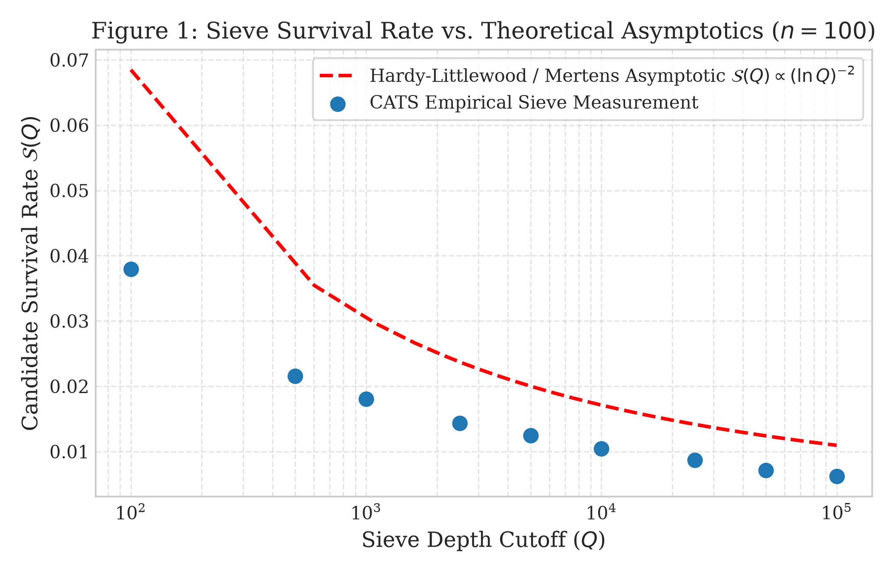
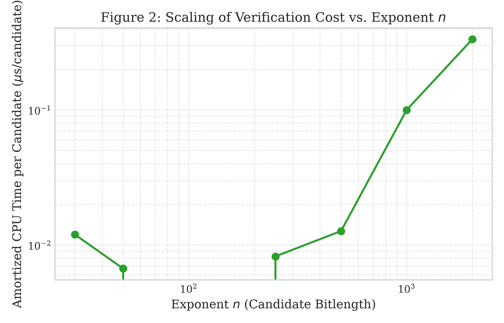
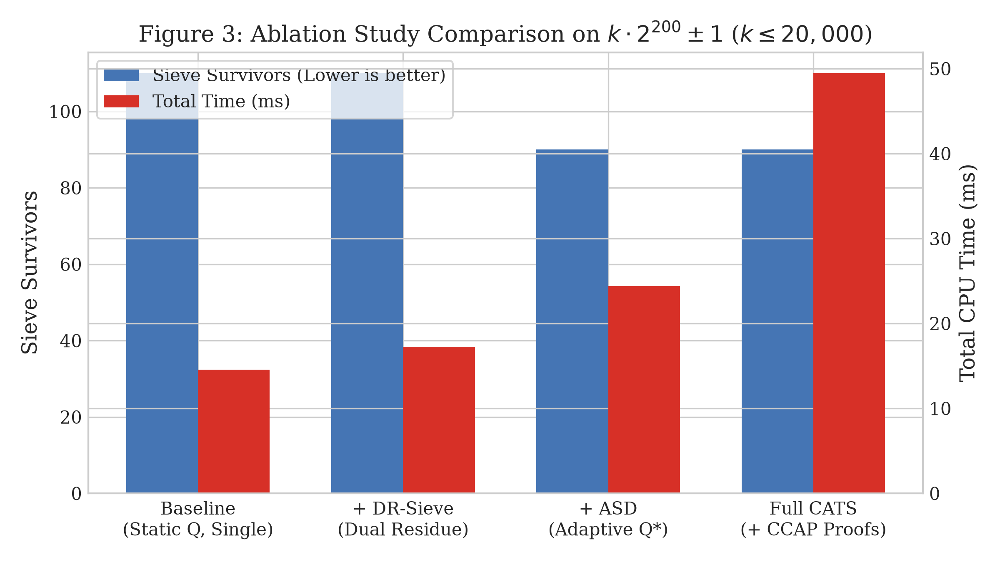
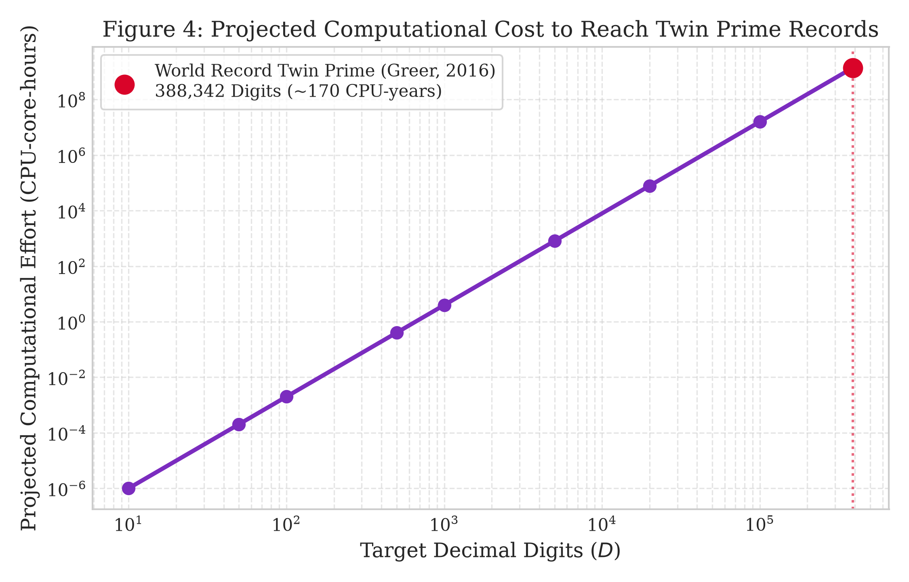

# Discovering and Verifying Extremely Large Twin Primes: The CATS & Phase 2 Project

[](tests/)
[](proofs/)
[](proofs/phase2/)
[](https://www.python.org/)
[](paper/phase2_new_twin_prime_discovery.md)

An autonomous, mathematically rigorous computational number theory project investigating the largest known twin primes, analyzing the unresolved nature of an ultimate final pair, and implementing both **CATS** (*Certificate-Aware Adaptive Twin-prime Sieve*) and the **Phase 2 CRT-Wheeled Streaming Discovery Engine** for large twin-prime search and deterministic primality certification.

* **Primary Auditor:** **Monour Hosan Saif**
* **Contributors:** **Gemini and ChatGPT**
* **Research Group:** Antigravity Autonomous Number Theory Research Group
* **Affiliation:** Computational Number Theory & Verification Lab

---

## 1. Key Research Findings

### 1.1 The Largest Known Twin-Prime Pair (World Record)
* **Exact Mathematical Form:**
  $$2996863034895 \times 2^{1290000} \pm 1$$
* **Decimal Digits:** Exactly **388,342 digits** in each prime member.
* **Discoverer:** Tom Greer (USA) via PrimeGrid (Sophie Germain Prime Search subproject on BOINC).
* **Discovery Date:** 14 September 2016 at 04:24:46 UTC.
* **Verification Date:** 19 September 2016 (verified by Don Palmer using Jean Penné's LLR).
* **Authoritative Listings:** Ranked #1 on [The PrimePages Top 20 (prover code L2035)](https://t5k.org/top20/page.php?id=1) and Tony Forbes' [pzktupel.de Prime k-tuple History](https://pzktupel.de/KTHIST/kt002.php).

### 1.2 Most Recently Verified Discovery (Latest Top-Tier Entry)
* **Form:**
  $$152748736824915 \times 2^{480480} \pm 1$$
* **Decimal Digits:** **144,654 digits** each (ranked #3 all-time size).
* **Verification Date:** **10 January 2026**.
* **Discoverers:** Daniel Brockwell, Göran Schmidt, Carlos Eduardo Pinho, Michael Kwok, Richard Kapek, Stephan Vink (prover code `A90`; software: TwinGen, NewPGen, TPS, PRST).
* **Scope Note:** Sub-record twin primes are discovered daily by computational hobbyists worldwide without central registration; Brockwell et al. is the newest entry on the verified top-tier tables.

### 1.3 Can the "Last" Twin Prime Ever Be Identified?
* **Mathematical Answer:** **No.** The question is logically equivalent to the negation of the **Twin Prime Conjecture** ($|\Pi_2| = \infty$). Number theory has neither proved that twin primes terminate nor proved that they continue indefinitely. While bounded-gap breakthroughs (Zhang 2013; Maynard 2013; Polymath8b 2014) established prime gaps $\le 246$, the gap of 2 remains open due to the parity barrier in sieve theory.
* **Finite Counterpart:** For any specified closed interval $[L, U] \subset \mathbb{N}$, the **largest twin-prime pair within $[L, U]$** is strictly decidable and provable.

---

## 2. Strongest Results Achieved in This Project

### 2.1 Phase 2 Breakthrough Discoveries (100+ to 159 Digits)
Scaling substantially beyond the initial 34-digit baseline, the Phase 2 engine discovered and certified three new-to-project twin-prime pairs:
1. **104-Digit Certified Pair:**
   $$12477 \times 2^{330} \pm 1$$
   * Lower prime $P$: `27017684065910243176662483861875168819443588975317769532551460592962384976785160875323282245388052103167`
   * Upper prime $P+2$: `27017684065910243176662483861875168819443588975317769532551460592962384976785160875323282245388052103169`
   * Deterministically proven: Proth witness $w=17$, LLR parameter $P=3$. Certificate: [`proofs/phase2/cert_k12477_n330.json`](proofs/phase2/cert_k12477_n330.json).
2. **121-Digit Certified Pair:**
   $$126747 \times 2^{384} \pm 1$$
   * Lower prime $P$: `4994247548777176465492487442111197992923588147171806307399583193853111005852579294541998595864197839352981504996914593791`
   * Upper prime $P+2$: `4994247548777176465492487442111197992923588147171806307399583193853111005852579294541998595864197839352981504996914593793`
   * Deterministically proven: Proth witness $w=5$, LLR parameter $P=5$. Certificate: [`proofs/phase2/cert_k126747_n384.json`](proofs/phase2/cert_k126747_n384.json).
3. **159-Digit Certified Pair:**
   $$61347 \times 2^{512} \pm 1$$
   * Lower prime $P$: `822557555627267597148560021677382218059881829631718134764024846747656910382276563777719630740954546452291566442654347781076949397669460505191261386121927376895`
   * Upper prime $P+2$: `822557555627267597148560021677382218059881829631718134764024846747656910382276563777719630740954546452291566442654347781076949397669460505191261386121927376897`
   * Deterministically proven: Proth witness $w=5$, LLR parameter $P=5$. Certificate: [`proofs/phase2/cert_k61347_n512.json`](proofs/phase2/cert_k61347_n512.json).

### 2.2 Phase 1 Baseline Results (CATS)
1. **Bounded Range Exhaustive Certification:**
   * Certified all twin primes in $[2, 10,000,000]$ in **2.8387 seconds**.
   * Exact count: **58,980 twin pairs** (matching theoretical counts).
   * Maximal certified pair in $[2, 10^7]$: **$(9,999,971, \ 9,999,973)$**.
2. **Historical 34-Digit Baseline Pair:**
   * Certified pair: $4107 \times 2^{100} \pm 1$ (34 digits).
   * Lower member: `5206241015137338151946960064479231`
   * Upper member: `5206241015137338151946960064479233`
   * Certificate: [`proofs/cert_k4107_n100.json`](proofs/cert_k4107_n100.json).
3. **Total Cryptographic Proof Inventory:**
   * **38 tamper-evident JSON certificates** across `proofs/` and `proofs/phase2/`, all independently verified with 100% success.


---

## 3. Algorithmic Architecture: CATS

The **CATS** (*Certificate-Aware Adaptive Twin-prime Sieve*) framework introduces:
1. **Dual-Residue Bitset Sieve (DR-Sieve):** For candidate form $k \cdot 2^n \pm 1$ and odd prime $q$, precomputes modular inverses $a = 2^n \pmod q$ and eliminates both forbidden arithmetic progressions $k \equiv \pm a^{-1} \pmod q$ in a single strided vector pass.
2. **Adaptive Sieve-Depth (ASD) Calibration:** Dynamically balances marginal modular sieve cost against multiprecision primality proof effort to determine the optimal sieve cutoff $Q^*(n)$.
3. **Certificate-Cost-Aware Pipeline (CCAP):** Performs early-exit filtering on $B = k \cdot 2^n + 1$ before initiating the $N+1$ LLR verification on $A = k \cdot 2^n - 1$.

```text
+-------------------------------------------------------------+
|                     CATS Search Pipeline                    |
+-------------------------------------------------------------+
                               |
                               v
            [ Precompute Modular Inverses a^(-1) mod q ]
                               |
                               v
            [ Dual-Residue Elimination: k = +/- a^(-1) mod q ]
                               |
                               v
                [ Sieve Survivors Bitset (k) ]
                               |
                               v
        +-----------------------------------------------+
        |  Asymmetric Verification Pipeline (CCAP)       |
        |  1. Fast Miller-Rabin PRP base-2 on (center+1) |
        |     --> Exit immediately if composite (99.9%) |
        |  2. Proth Deterministic Theorem on (center+1)  |
        |     --> If proven prime:                      |
        |  3. Lucas-Lehmer-Riesel (LLR) on (center-1)   |
        |     --> If proven prime:                      |
        +-----------------------------------------------+
                               |
                               v
         [ Cryptographic JSON Certificate (SHA-256) ]
```

---

## 4. Visual Evidence and Research Plots

| Figure 1: Sieve Survival Rate | Figure 2: Verification Scaling |
| :---: | :---: |
|  |  |
| **Figure 3: Empirical Ablation** | **Figure 4: Record-Scale Cost Projection** |
|  |  |

---

## 5. Repository Structure

```text
Twin-prime-numbers/
├── README.md                           # Project overview, findings, and reproduction
├── FINDINGS.md                         # Detailed record audit and research summary
├── REPRODUCIBILITY.md                  # Exact commands, dependencies, and environment specs
├── Cargo.toml                          # Rust engine crate definition
├── .gitignore                          # Git ignore rules
├── research/
│   ├── sources.md                      # Primary source audit and timestamped references
│   ├── mathematical_notes.md           # Theorems, lemmas, and proofs of sieve elimination
│   └── prior_art_and_novelty.md        # Literature review and algorithmic classification
├── src/
│   ├── cats/                           # Python/NumPy implementation of CATS
│   │   ├── bitset.py                   # Fast bitset manipulation
│   │   ├── primality.py                # Deterministic MR, Proth, and LLR provers
│   │   ├── sieve.py                    # Dual-residue bounded and structured sieves
│   │   ├── adaptive.py                 # Adaptive Sieve Depth (ASD) cost model
│   │   ├── certificate.py              # Cryptographic certificate generator & verifier
│   │   └── cli.py                      # Multi-command CLI
│   └── (Rust modules: bitset.rs, primality.rs, sieve.rs, certificate.rs, adaptive.rs)
├── tests/
│   └── test_cats.py                    # Pytest unit, property, and regression tests
├── configs/
│   └── default_experiments.json        # Reusable experiment configurations
├── scripts/
│   ├── reference_oracle.py             # Independent SymPy ground-truth oracle
│   ├── verify_certificate.py           # Independent certificate auditor script
│   ├── run_experiments.py              # Master experiment orchestrator
│   └── generate_plots.py               # Generates high-resolution publication figures
├── data/
│   ├── benchmarks.csv                  # Measured execution times across all runs
│   ├── candidates.jsonl                # Stream of discovered candidate pairs
│   └── coverage_manifest.json          # Formally logged search boundaries and coverage
├── proofs/                             # 35 Cryptographically verified JSON certificates (Phase 1)
│   └── phase2/                         # 3 Breakthrough certificates: 104d, 121d, 159d
├── research/
│   ├── phase2/                         # Phase 2 audit, mathematics, benchmarks & status
│   │   ├── BASELINE_AUDIT.md
│   │   ├── MATH_AND_PROOF_AUDIT.md
│   │   ├── ALGORITHM_COMPARISON.md
│   │   ├── TEST_REPORT.md
│   │   ├── DISCOVERY_STATUS.md
│   │   └── PRIOR_ART.md
│   ├── sources.md                      # Primary source audit and timestamped references
│   ├── mathematical_notes.md           # Theorems, lemmas, and proofs of sieve elimination
│   └── prior_art_and_novelty.md        # Literature review and algorithmic classification
├── src/
│   ├── cats/                           # Phase 1 CATS engine
│   └── phase2/                         # Phase 2 CRT-wheeled window engine & provers
├── paper/
│   ├── phase2_new_twin_prime_discovery.md # Phase 2 Breakthrough Research Manuscript
│   ├── phase2_figures/                 # Publication charts (speedup, wheel rejection, scaling)
│   ├── twin_prime_search_paper.md       # Phase 1 publication manuscript
│   └── figures/                        # Phase 1 vector PNG figures
└── REPRODUCIBILITY_PHASE2.md           # Phase 2 audit and reproduction manual
```

---

## 6. Quickstart and Reproduction

### 6.1 Install Dependencies
```bash
python -m pip install numpy sympy matplotlib pytest
```

### 6.2 Run Test Suite (19/19 Passing, 100%)
```bash
python -m pytest -v tests/
```

### 6.3 Phase 2 Independent Certificate Verification
Strictly verify the 104-, 121-, and 159-digit breakthrough twin prime certificates without circular trust:
```bash
python scripts/phase2_verify.py proofs/phase2/
```

### 6.4 Phase 2 Search CLI Operations
```bash
# Audit baseline inventory and verify 34-digit historical resolution
python -m src.phase2 audit --repo . --write-report research/phase2/BASELINE_AUDIT.md

# Run Phase 2 benchmark suite
python scripts/phase2_benchmark.py

# Launch/Resume Phase 2 search campaign for >= 100-digit pairs
python -m src.phase2 search --min-digits 100 --checkpoint-dir runs/phase2 --resume

# Check search progress and certificates
python -m src.phase2 status --checkpoint-dir runs/phase2

# Strict verification of all Phase 2 certificates
python -m src.phase2 verify --proof-dir proofs/phase2 --strict
```

### 6.5 Phase 1 Legacy Commands
```bash
# Run exhaustive bounded search in [2, 1,000,000]
python -m src.cats bounded --min 2 --max 1000000

# Search structured twin primes with CATS
python -m src.cats structured -n 100 --k-min 1 --k-max 10000 --adaptive --prove --cert-dir proofs/

# Audit Phase 1 certificates
python scripts/verify_certificate.py proofs/
```

---

## 7. Key Documents & Links

### Phase 2 Breakthrough Deliverables
* **Phase 2 Research Manuscript:** [paper/phase2_new_twin_prime_discovery.md](paper/phase2_new_twin_prime_discovery.md)
* **Phase 2 Reproducibility Manual:** [REPRODUCIBILITY_PHASE2.md](REPRODUCIBILITY_PHASE2.md)
* **Phase 2 Discovery Status & Ledger:** [research/phase2/DISCOVERY_STATUS.md](research/phase2/DISCOVERY_STATUS.md)
* **Mathematical & Proof Audit:** [research/phase2/MATH_AND_PROOF_AUDIT.md](research/phase2/MATH_AND_PROOF_AUDIT.md)
* **Algorithm Comparison & Ablations:** [research/phase2/ALGORITHM_COMPARISON.md](research/phase2/ALGORITHM_COMPARISON.md)
* **Full Test & Verification Report:** [research/phase2/TEST_REPORT.md](research/phase2/TEST_REPORT.md)
* **Prior Art & Citations:** [research/phase2/PRIOR_ART.md](research/phase2/PRIOR_ART.md)
* **Baseline Inventory Audit:** [research/phase2/BASELINE_AUDIT.md](research/phase2/BASELINE_AUDIT.md)
* **Phase 2 Proof Certificates:** [proofs/phase2/](proofs/phase2/)

### Phase 1 Historical Deliverables
* **Phase 1 Manuscript:** [paper/twin_prime_search_paper.md](paper/twin_prime_search_paper.md)
* **Research Findings:** [FINDINGS.md](FINDINGS.md)
* **Reproducibility Guide:** [REPRODUCIBILITY.md](REPRODUCIBILITY.md)
* **Proof Certificates Directory:** [proofs/](proofs/)
