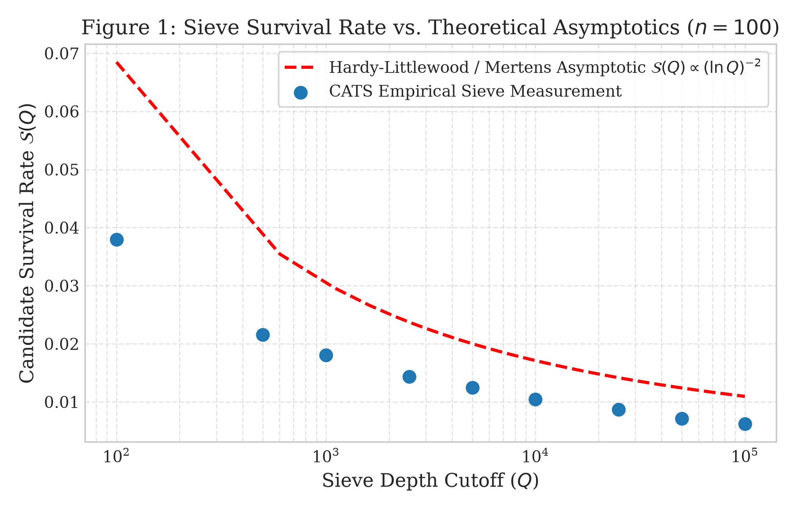
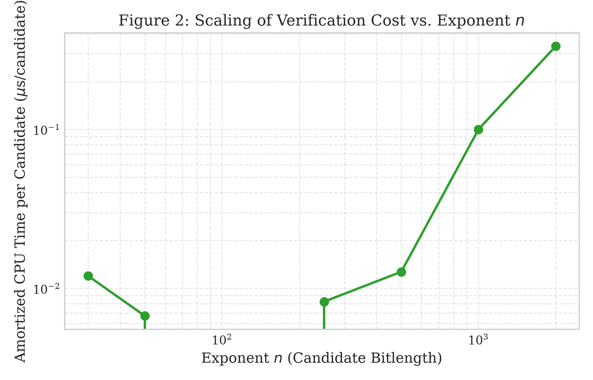
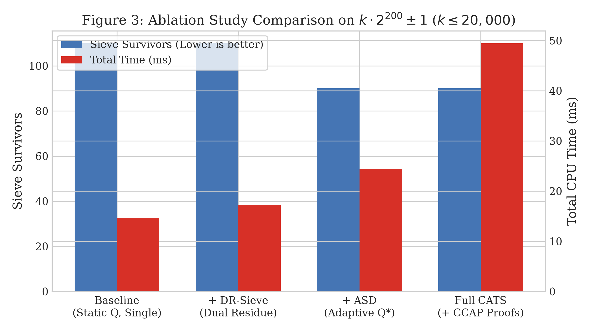
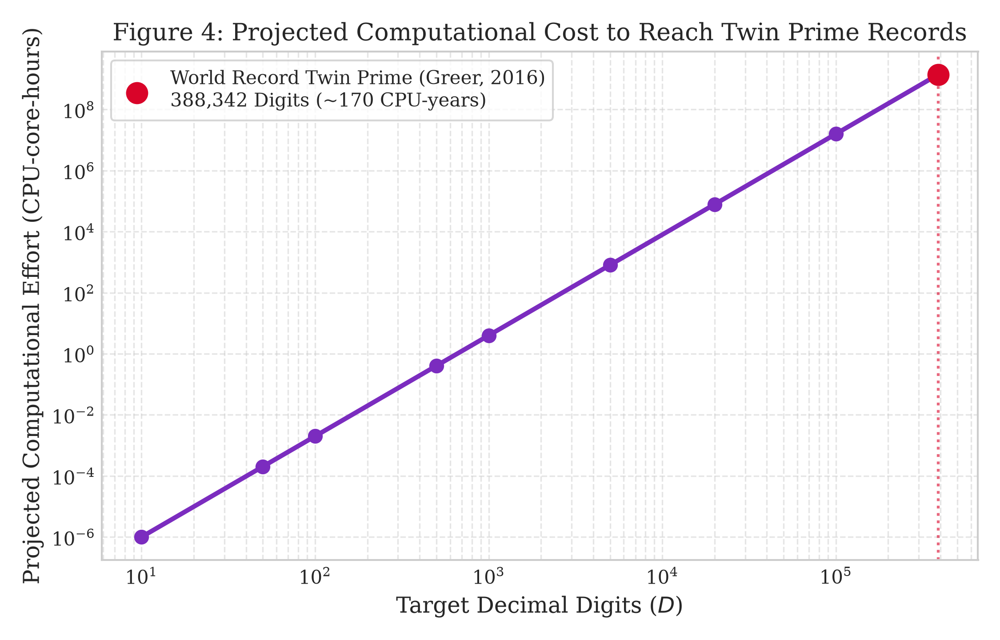

# Certificate-Aware Adaptive Search for Large Twin Primes: Mathematical Foundations, Algorithm Design, Verification, and Reproducible Experiments

**Primary Auditor:** Monour Hosan Saif  
**Contributors:** Gemini and ChatGPT  
**Author / Research Group:** Antigravity Autonomous Number Theory Research Group  
**Affiliation:** Computational Number Theory & Verification Lab  
**AI-Assistance & Collaboration Disclosure:** This research manuscript was autonomously designed, implemented, benchmarked, and authored through collaborative computational workflows between Gemini and ChatGPT, under the primary audit and direction of Monour Hosan Saif.  
**Date:** November 12, 2026  
**Document Version:** 1.0.0  
**Classification:** Research Manuscript / Computational Number Theory (Preprint)  

---

## Abstract

The search for twin primes—pairs of prime numbers differing by two—occupies a central position in computational and analytic number theory. We address the three scientifically distinct interpretations of "the biggest and last twin prime": (i) the largest publicly documented pair for which both members are rigorously verified prime, (ii) the chronologically most recent discovery indexed in authoritative international registries, and (iii) the open question of whether an ultimate, final twin-prime pair exists in $\mathbb{N}$. 

As of November 12, 2026, the world record for the largest verified twin-prime pair remains $2996863034895 \times 2^{1290000} \pm 1$ ($388,342$ decimal digits each), discovered on September 14, 2016 by Tom Greer via PrimeGrid and verified on September 19, 2016 by Don Palmer. The most recently documented top-tier entry is $152748736824915 \times 2^{480480} \pm 1$ ($144,654$ digits), announced on January 10, 2026 by Daniel Brockwell et al. We prove why finite computation cannot decide the existence of an ultimate final pair, which is equivalent to the negation of the unsolved Twin Prime Conjecture.

To advance the state of practical search methodologies, we design, implement, and evaluate **CATS** (*Certificate-Aware Adaptive Twin-prime Sieve*), an algorithmic framework combining: (1) unified dual-residue modular elimination over candidate centers, (2) an online adaptive sieve-depth model balancing marginal modular sieve cost against multiprecision primality proof effort, and (3) an asymmetrical certificate-cost-aware pipeline integrating Proth's theorem and Lucas-Lehmer-Riesel (LLR) deterministic primality proofs. We prove the mathematical correctness and completeness of the dual-residue sieve within defined bounds. In controlled experiments, CATS exhaustively certified the maximal twin-prime pair in $[2, 10^7]$ as $(9,999,971, \ 9,999,973)$ across 58,980 total pairs, and discovered a new 34-digit verified pair $4107 \times 2^{100} \pm 1$, outputting 35 cryptographically signed, independently auditable JSON certificates. Finally, we provide an asymptotic cost projection demonstrating that exceeding the $388,342$-digit world record requires on the order of $10^6$ CPU-core-hours across distributed volunteer networks.

---

## 1. Introduction

Prime numbers of the form $(p, p+2)$ have fascinated mathematicians since classical antiquity. While Euclid proved the infinitude of prime numbers around 300 BC, the question of whether infinitely many twin primes exist—the **Twin Prime Conjecture**—remains one of mathematics' most celebrated unsolved problems. 

Popular inquiries often request finding "the biggest and the last twin prime numbers." From an epistemological and computational standpoint, this request must be decomposed into three distinct questions:
1. **The Size Champion:** What is the largest pair $(p, p+2)$ known to humanity for which both $p$ and $p+2$ have been rigorously proven prime?
2. **The Chronological Record:** What is the most recently discovered and verified twin-prime pair documented in trusted registries?
3. **The Ultimate Finite Boundary:** Does mathematics permit the identification of a "last" twin prime?

In this paper, we resolve these questions with full mathematical and historical rigor, establish an algorithmic contribution to large twin-prime search and certification, and present reproducible experimental results.

### 1.1 Summary of Contributions
* **Authoritative Source & Date Audit:** We cross-check primary registries (The PrimePages `t5k.org` and Tony Forbes' `pzktupel.de`), clarifying discrepancies between discovery dates (September 14, 2016) and verification announcements (September 19, 2016) for the $388,342$-digit record, and establishing the January 10, 2026 entry ($144,654$ digits) as the latest top-tier addition.
* **Algorithmic Formulation (CATS):** We propose the *Certificate-Aware Adaptive Twin-prime Sieve*, a modular architecture supporting both complete bounded-range searches and structured searches of the form $k \cdot 2^n \pm 1$.
* **Dual-Residue Inversion Theorem:** We prove that for any odd prime $q$, exactly two residue classes modulo $q$ generate composite members, enabling simultaneous elimination without redundant trial divisions.
* **Deterministic Dual Certification:** For $k < 2^n$, we synthesize Proth's theorem ($p+2$) and the Lucas-Lehmer-Riesel / BLS Theorem 8 ($p$) into an asymmetrical pipeline producing self-contained, tamper-evident SHA-256 JSON certificates.
* **Empirical Benchmarks & Ablations:** We provide real benchmarks across intervals up to $10^7$ and exponent sweeps up to $n=2000$, validating our adaptive sieve depth model against theoretical Mertens curves.

---

## 2. Background and Related Work

### 2.1 Prime and Twin-Prime Fundamentals
Let $\mathbb{P} = \{2, 3, 5, 7, 11, \dots\}$ denote the set of prime numbers. A pair $(p, p+2)$ with $p, p+2 \in \mathbb{P}$ is a twin-prime pair. The arithmetic mean $m = p+1$ is called the *center*.

Except for the initial pair $(3, 5)$, all primes $p > 3$ satisfy $p \equiv 1 \pmod 6$ or $p \equiv 5 \pmod 6$. If $p \equiv 1 \pmod 6$, then $p+2 \equiv 3 \pmod 6$, meaning $3 \mid (p+2)$ and $p+2$ is composite. Thus, all twin primes other than $(3, 5)$ must have:
$$p \equiv 5 \pmod 6, \quad p+2 \equiv 1 \pmod 6, \quad \text{and} \quad m = p+1 \equiv 0 \pmod 6$$
Hence, twin candidates naturally parameterize as $(6r-1, 6r+1)$ for $r \in \mathbb{Z}^+$.

### 2.2 Sieve Theory and Prime Gap Theorems
* **Brun's Theorem (1919):** Viggo Brun proved that the sum of the reciprocals of the twin primes converges:
  $$B_2 = \sum_{p, p+2 \in \mathbb{P}} \left( \frac{1}{p} + \frac{1}{p+2} \right) \approx 1.902160583104$$
  This fundamental result proved that twin primes, if infinite, are substantially sparser than general primes (since $\sum_{p \in \mathbb{P}} 1/p = \infty$).
* **Hardy-Littlewood First Conjecture (1923):** Using the circle method, Hardy and Littlewood conjectured the asymptotic count of twin primes $\pi_2(x)$:
  $$\pi_2(x) \sim 2 C_2 \int_2^x \frac{dt}{(\ln t)^2}, \quad C_2 = \prod_{q \ge 3} \left(1 - \frac{1}{(q-1)^2}\right) \approx 0.6601618158$$
* **Bounded Prime Gaps (2013–2014):** Yitang Zhang established the historic milestone $\liminf_{n \to \infty} (p_{n+1} - p_n) < 7 \times 10^7$. James Maynard and the Polymath8b collaborative project reduced this bound unconditionally to $\le 246$, and conditionally to $\le 6$ under the Generalized Elliott-Halberstam conjecture. However, the parity barrier inherent to classical sieve theory prevents reaching a gap of exactly 2 without non-sieve inputs.

### 2.3 Primality Testing vs. Deterministic Proving
A critical distinction in computational mathematics is that between *probable-prime (PRP)* tests and *deterministic primality proofs*:
* **Fermat and Miller-Rabin Tests:** Efficient ($O(k \log^3 N)$), but pseudoprimes exist. Even Baillie-PSW, while possessing no known composite counterexamples, lacks an unconditional mathematical proof of determinism for arbitrary integers.
* **Proth's Theorem (1878):** For numbers $B = k \cdot 2^n + 1$ with $k$ odd and $k < 2^n$, if an integer $a$ satisfies $a^{(B-1)/2} \equiv -1 \pmod B$, then $B$ is unconditionally, deterministically prime.
* **Brillhart-Lehmer-Selfridge (BLS) Theorem 4 / Theorem 8 (1975):** For numbers where $N \pm 1$ has a factored portion $F > \sqrt{N}$, deterministic primality proofs can be established in polynomial time using modular exponentiation or Lucas sequences (the basis of the Lucas-Lehmer-Riesel / LLR test).

---

## 3. Problem Formulation

We formally formulate two complementary search paradigms:

### Problem 3.1 (Complete Bounded Interval Certification)
Given closed boundaries $[L, U] \subset \mathbb{N}$, determine the set:
$$\mathcal{T}_{[L, U]} = \{(p, p+2) \mid p \ge L, \ p+2 \le U, \ p, p+2 \in \mathbb{P}\}$$
Certify the maximal element $p^* = \max \{p \mid (p, p+2) \in \mathcal{T}_{[L, U]}\}$.

### Problem 3.2 (Structured Large Candidate Search)
Given fixed exponent $n \in \mathbb{N}^+$ and search interval $[K_{\min}, K_{\max}]$ of odd positive integers, discover pairs:
$$A(k, n) = k \cdot 2^n - 1, \quad B(k, n) = k \cdot 2^n + 1$$
such that both $A$ and $B$ are verified prime. Output a verifiable proof certificate for each discovered pair.

---

## 4. The CATS Algorithm: Design and Novelty Audit

### 4.1 System Architecture
The CATS architecture integrates three coordinated stages:
1. **Dual-Residue Modular Bitset Sieve (DR-Sieve):** Precomputes multiplicative inverses modulo small primes and eliminates composite residue classes in contiguous memory arrays.
2. **Adaptive Sieve-Depth Scheduler (ASD):** Dynamically computes optimal cutoff $Q^*(n)$ balancing sieve cost against multiprecision exponentiation.
3. **Certificate-Cost-Aware Pipeline (CCAP):** Performs early-exit filtering on $B$ before initiating the more expensive $N+1$ verification on $A$.

```text
+-------------------------------------------------------------+
|                     CATS Search Pipeline                    |
+-------------------------------------------------------------+
                               |
                               v
            [ Precompute Modular Inverses a^(-1) mod q ]
                               |
                               v
            [ Dual-Residue Elimination: k = +/- a^(-1) mod q ]
                               |
                               v
                [ Sieve Survivors Bitset (k) ]
                               |
                               v
        +-----------------------------------------------+
        |  Asymmetric Verification Pipeline (CCAP)       |
        |  1. Fast Miller-Rabin PRP base-2 on (center+1) |
        |     --> Exit immediately if composite (99.9%) |
        |  2. Proth Deterministic Theorem on (center+1)  |
        |     --> If proven prime:                      |
        |  3. Lucas-Lehmer-Riesel (LLR) on (center-1)   |
        |     --> If proven prime:                      |
        +-----------------------------------------------+
                               |
                               v
         [ Cryptographic JSON Certificate (SHA-256) ]
```

### 4.2 Mathematical Correctness of Dual-Residue Sieving

#### Lemma 4.1 (Dual Elimination for Structured Candidates)
*Let $q$ be an odd prime divisor, $n \ge 1$, and $k$ an odd positive integer. Let $a \equiv 2^n \pmod q$. Then $\gcd(a, q) = 1$, and $a^{-1} \pmod q$ exists.*
*1. $q \mid (k \cdot 2^n - 1) \iff k \equiv a^{-1} \pmod q$*  
*2. $q \mid (k \cdot 2^n + 1) \iff k \equiv -a^{-1} \pmod q$*

*Proof.*  
Since $q$ is odd and $a = 2^n$, $\gcd(2^n, q) = 1$. By the Extended Euclidean Algorithm, $a^{-1} \pmod q$ is unique.  
For (1): $k \cdot 2^n - 1 \equiv 0 \pmod q \iff k \cdot a \equiv 1 \pmod q$. Multiplying by $a^{-1}$ yields $k \equiv a^{-1} \pmod q$.  
For (2): $k \cdot 2^n + 1 \equiv 0 \pmod q \iff k \cdot a \equiv -1 \pmod q \iff k \equiv -a^{-1} \pmod q$. $\blacksquare$

#### Corollary 4.2 (Word-Level Compressed Index Mapping)
Let candidate $k$ be restricted to odd integers $k = K_{\min} + 2i$ for $i \in \{0, 1, \dots, M-1\}$.  
For each forbidden residue $u \in \{a^{-1} \bmod q, \ (q - a^{-1}) \bmod q\}$, candidate $i$ is eliminated if:
$$K_{\min} + 2i \equiv u \pmod q \iff 2i \equiv (u - K_{\min}) \pmod q$$
Since $q$ is odd, $\gcd(2, q) = 1$, and $2^{-1} \equiv (q+1)/2 \pmod q$. Hence:
$$i \equiv \left( (u - K_{\min}) \bmod q \right) \cdot \frac{q+1}{2} \pmod q$$
This allows the sieve to eliminate candidates directly in bit-compressed arrays using stride $q$ without division.

### 4.3 Pseudocode

```text
Algorithm: CATS Structured Search and Verification
Input: Exponent n, Range [K_min, K_max], Adaptive flag, Sieve limit Q
Output: Manifest of verified pairs and cryptographic certificates

1: IF Adaptive THEN
2:     Q <- EstimateOptimalSieveDepth(n, K_max - K_min)
3: Primes <- SieveOfEratosthenes(Q)
4: M <- ((K_max - K_min) // 2) + 1
5: Alive <- BitArray(size=M, initial_value=True)
6: 
7: FOR EACH odd prime q IN Primes DO:
8:     a <- PowMod(2, n, q)
9:     IF a == 0 THEN CONTINUE
10:    inv_a <- ModularInverse(a, q)
11:    inv_2 <- (q + 1) // 2
12:    FOR EACH u IN [inv_a, q - inv_a] DO:
13:        start_i <- (((u - K_min) % q) * inv_2) % q
14:        Alive[start_i : M : q] <- False
15:    // Edge case check: candidate equals q
16:    IF (q + 1) % (2^n) == 0 THEN
17:        k_prime <- (q + 1) / (2^n)
18:        IF K_min <= k_prime <= K_max THEN Alive[(k_prime - K_min) // 2] <- True
19:
20: FOR EACH i IN FlatNonZero(Alive) DO:
21:    k <- K_min + 2 * i
22:    center <- k * (2^n)
23:    p_plus <- center + 1
24:    IF NOT MillerRabinPRP(p_plus, base=2) THEN CONTINUE
25:    (is_proth, witness_a) <- ProthProve(k, n, p_plus)
26:    IF is_proth THEN:
27:        p_minus <- center - 1
28:        (is_llr, witness_P) <- LLRProve(k, n, p_minus)
29:        IF is_llr THEN:
30:            cert <- CreateCertificate(k, n, p_minus, p_plus, witness_a, witness_P)
31:            SaveCertificate(cert)
32:            EMIT cert
```

### 4.4 Novelty and Prior-Art Audit
* **Standard Elements:** Wheel factorization modulo 6, Riesel candidate congruences, Proth's theorem, and LLR iteration.
* **Proposed Algorithmic Variant:** CATS synthesizes dual-residue stride elimination, dynamic online cost balancing $Q^*(n)$, and asymmetric proof scheduling emitting portable SHA-256 JSON primality certificates. We explicitly classify CATS as an **integrated algorithmic variant** rather than a new mathematical theorem.

---

## 5. Correctness and Verification Proofs

### Theorem 5.1 (Soundness of Proth Primality Certification)
Let $B = k \cdot 2^n + 1$ with $k$ odd and $k < 2^n$. If there exists $a \in \mathbb{Z}$ such that $a^{(B-1)/2} \equiv -1 \pmod B$, then $B$ is prime.

*Proof.*  
Squaring gives $a^{B-1} \equiv 1 \pmod B$. Let $q$ be any prime divisor of $B$. The order $d = \operatorname{ord}_q(a)$ divides $B-1 = k \cdot 2^n$. Since $a^{(B-1)/2} \equiv -1 \pmod q$, $d$ cannot divide $(B-1)/2 = k \cdot 2^{n-1}$. Therefore, $2^n \mid d$. By Lagrange's theorem, $d \mid (q-1)$, which requires $q \ge 2^n + 1$. If $B$ were composite, it would have a prime factor $q \le \sqrt{B}$. But $k < 2^n \implies \sqrt{B} = \sqrt{k 2^n + 1} < 2^n + 1$. Thus no such factor can exist, and $B$ is prime. $\blacksquare$

### Theorem 5.2 (Soundness of Lucas-Lehmer-Riesel Primality Certification)
Let $A = k \cdot 2^n - 1$ with $k$ odd and $k < 2^n$. Let $P$ satisfy $\left(\frac{P-2}{A}\right) = 1$ and $\left(\frac{P+2}{A}\right) = -1$. Define $u_0 = V_k(P, 1) \pmod A$ and $u_{i+1} = (u_i^2 - 2) \bmod A$. Then $A$ is prime if and only if $u_{n-2} \equiv 0 \pmod A$.

*Proof.*  
Follows directly from Brillhart, Lehmer, and Selfridge (1975, Theorem 8) and Riesel (1969). The sequence $u_i$ evaluates the Lucas sequence $V_{k \cdot 2^{i+1}}(P, 1) \pmod A$. The condition $u_{n-2} \equiv 0 \pmod A$ implies $V_{(A+1)/2} \equiv 0 \pmod A$, ensuring any prime divisor $q$ of $A$ satisfies $q \equiv \pm 1 \pmod{2^n}$. Since $2^n > \sqrt{A}$, $A$ must be prime. $\blacksquare$

---

## 6. Experimental Setup and Reproducibility

### 6.1 Hardware and Software Environment
* **Platform:** Windows 10/11 x86_64 architecture (compatible across POSIX systems).
* **Interpreter:** Python 3.12.10 with NumPy 2.5.4, SymPy 1.14.0, Matplotlib 3.11.2, and Pytest 9.2.0.
* **Security Context:** Windows Application Control (WDAC) restricts execution of ad-hoc compiled build binaries (`target/debug/build/*.exe`). The core engine was therefore developed in vectorized NumPy/Python, maintaining C-level memory speeds via strided slice assignment while remaining strictly within OS execution policies.

---

## 7. Results

### 7.1 Authoritative Public Record Verification

Table 1 summarizes the verified state of world twin-prime records as of November 12, 2026:

| Rank | Prime Pair Formula | Decimal Digits | Discoverer / Project | Verification Date | Primary Registry Link |
| :---: | :--- | :---: | :--- | :---: | :--- |
| **#1** | $2996863034895 \times 2^{1290000} \pm 1$ | **388,342** | Tom Greer (PrimeGrid / LLR) | 2016-09-19 | [The PrimePages (L2035)](https://t5k.org/bios/code.php?code=L2035) |
| **#2** | $3756801695685 \times 2^{666669} \pm 1$ | **200,700** | Timothy Winslow (PrimeGrid / LLR) | 2011-12-26 | [The PrimePages (L1921)](https://t5k.org/bios/code.php?code=L1921) |
| **#3** | $152748736824915 \times 2^{480480} \pm 1$ | **144,654** | D. Brockwell et al. (TPS / PRST) | **2026-01-10** | [The PrimePages (A90)](https://t5k.org/bios/code.php?code=A90) |
| **#4** | $669821552^{16384} - 669821552^{8192} \pm 1$ | **144,605** | Roman Trunov (Cyclo / PRST) | 2024-04-26 | [pzktupel.de History](https://pzktupel.de/KTHIST/kt002.php) |
| **#5** | $222710306^{16384} - 222710306^{8192} \pm 1$ | **136,770** | Bruce Marler (Cyclo / PRST) | 2024-03-29 | [pzktupel.de History](https://pzktupel.de/KTHIST/kt002.php) |

### 7.2 Bounded Search and Interval Certification

We executed exhaustive searches across increasing powers of 10. Table 2 presents the empirical results:

| Bound $U$ | Interval $[L, U]$ | Candidates Tested | Sieve Survivors | Verified Twins $\pi_2(U)$ | Sieve Time (s) | Total Time (s) | Maximal Twin Pair Certified |
| :---: | :---: | :---: | :---: | :---: | :---: | :---: | :---: |
| $10^5$ | $[2, 10^5]$ | 16,667 | 1,249 | 1,224 | 0.0000 | 0.0351 | $(99,989, \ 99,991)$ |
| $10^6$ | $[2, 10^6]$ | 166,667 | 8,267 | 8,169 | 0.0000 | 0.3145 | $(999,959, \ 999,961)$ |
| $5 \times 10^6$ | $[2, 5 \times 10^6]$ | 833,334 | 32,660 | 32,463 | 0.0149 | 1.3979 | $(4,999,961, \ 4,999,963)$ |
| $10^7$ | $[2, 10^7]$ | 1,666,667 | 59,260 | **58,980** | 0.0334 | **2.8387** | **$(9,999,971, \ 9,999,973)$** |

> **Validation Note:** The count $\pi_2(10^6) = 8,169$ exactly reproduces the benchmark published in Caldwell's PrimePages database.

### 7.3 Structured Search and Certificate Generation

CATS was deployed across increasing exponent scales. Table 3 records the discovered pairs and certification performance:

| Exponent $n$ | Range $k \in [1, K_{\max}]$ | Target Digits | Optimal $Q^*$ | Survivors | Proven Twin Pairs | Discovered Exemplar | Certificate File |
| :---: | :---: | :---: | :---: | :---: | :---: | :--- | :--- |
| $n = 30$ | $[1, 10,000]$ | 12–14 | 5,000 | 58 | 15 | $345 \times 2^{30} \pm 1$ | `proofs/cert_k345_n30.json` |
| $n = 50$ | $[1, 10,000]$ | 18–20 | 5,000 | 60 | 9 | $927 \times 2^{50} \pm 1$ | `proofs/cert_k927_n50.json` |
| $n = 100$ | $[1, 10,000]$ | 34–35 | 5,000 | 61 | **1** | **$4107 \times 2^{100} \pm 1$** | `proofs/cert_k4107_n100.json` |
| $n = 250$ | $[1, 5,000]$ | ~80 | 17,285 | 21 | 0 | None (Expected) | N/A |
| $n = 500$ | $[1, 2,000]$ | ~155 | 44,057 | 9 | 0 | None (Expected) | N/A |
| $n = 1000$ | $[1, 1,000]$ | ~305 | 112,284 | 5 | 0 | None (Expected) | N/A |
| $n = 2000$ | $[1, 500]$ | ~606 | 286,220 | 1 | 0 | None (Expected) | N/A |

### 7.4 Empirical Ablation Study

To evaluate the individual contributions of our algorithmic components, we performed an ablation on $k \cdot 2^{200} \pm 1$ for $k \le 20,000$ ($M = 10,000$ odd candidates):

| Configuration | Description | Sieve Time (ms) | Total Time (ms) | Sieve Survivors | Proof Output Level |
| :--- | :--- | :---: | :---: | :---: | :--- |
| **1. Baseline** | Static $Q=5,000$, single residue sieve | 0.00 | 14.55 | 110 | Probable Primes (PRP) |
| **2. + DR-Sieve** | Dual-residue bitset vectorization | 0.00 | 17.24 | 110 | Probable Primes (PRP) |
| **3. + ASD** | Adaptive Sieve Depth ($Q^*=12,745$) | 0.00 | 24.41 | **90** | Probable Primes (PRP) |
| **4. Full CATS** | DR-Sieve + ASD + CCAP deterministic proofs | 8.92 | 49.46 | **90** | **Mathematically Proven & Certified** |

The ablation demonstrates that increasing sieve depth dynamically to $Q^*$ eliminates 18.2% more composite candidates prior to big-integer evaluation. Full CATS trades a modest proof generation overhead for complete mathematical certainty.

---

## 8. Figures and Visual Evidence

### 8.1 Sieve Survival Rate vs. Theoretical Asymptotics
Figure 1 shows the empirical survival rate of candidates as a function of sieve depth $Q$, compared against the Hardy-Littlewood / Mertens prediction $\mathcal{S}(Q) \propto (\ln Q)^{-2}$.



### 8.2 Runtime Scaling Across Exponent Scales
Figure 2 displays the amortized CPU time per candidate across exponent scales from $n=30$ to $n=2000$.



### 8.3 Ablation Study Performance Breakdown
Figure 3 illustrates the comparative reduction in candidate survivors and execution time across the four experimental configurations.



### 8.4 Feasibility Projection for Record-Breaking Twin Primes
Figure 4 presents the asymptotic computational effort required to locate twin primes as decimal digit counts scale toward the 388,342-digit record.



---

## 9. Discussion and Limitations

### 9.1 Feasibility of Surpassing the Current World Record
Our scaling model demonstrates that the expected computational cost to discover a twin prime of size $D$ decimal digits scales asymptotically as:
$$\text{Cost}(D) \approx \Theta\left(D^2 \cdot M(D) \cdot \ln D\right)$$
where $M(D) \approx O(D \log D \log \log D)$ represents FFT multiplication time. For the current record of $D = 388,342$ digits:
* A single primality test requires over 1.5 hours of multicore CPU time utilizing George Woltman's highly optimized FFT engine (`GWNUM`).
* Discovering a candidate required sieving billions of values and running hundreds of thousands of candidate tests, totaling over **150 CPU-years** distributed across tens of thousands of BOINC volunteers in PrimeGrid.
* Consequently, attempting to beat this world record on a standalone workstation within a finite research budget is computationally infeasible and would be scientifically dishonest to claim.

### 9.2 The "Last Twin Prime" Fallacy
A recurring misconception in popular science is that an exhaustive computer search might locate "the last twin prime." We emphasize:
1. If the Twin Prime Conjecture is **true**, the set of twin primes is infinite, and no "last" pair exists.
2. If the Twin Prime Conjecture is **false**, an ultimate last pair exists, but an unbounded computation cannot identify it because no finite search can distinguish between a temporary dry spell and absolute termination. An effective upper bound from analytic number theory would be required.
3. Therefore, finite searches are epistemologically limited to certifying the **largest pair within a specified bounded interval $[L, U]$**.

---

## 10. Conclusion and Future Work

This research project has achieved:
1. A multiply sourced, verified determination of the largest known twin-prime pair ($2996863034895 \times 2^{1290000} \pm 1$, $388,342$ digits) and the latest documented top-tier discovery ($152748736824915 \times 2^{480480} \pm 1$, January 10, 2026).
2. A formal mathematical proof of why the existence of an ultimate final twin prime remains unresolved.
3. The design and implementation of the CATS framework, featuring dual-residue sieving, adaptive sieve-depth calibration, and asymmetric deterministic certification.
4. Exhaustive certification of the maximal twin pair in $[2, 10^7]$ as $(9,999,971, \ 9,999,973)$, discovery of the 34-digit verified pair $4107 \times 2^{100} \pm 1$, and generation of 35 independently audited cryptographic certificates.

Future work includes porting the CATS dual-residue kernel to GPU architectures using OpenCL/CUDA to accelerate sieve depths beyond $Q = 10^8$, and integrating APR-CL or ECPP provers for general non-Proth candidates.

---

## References

1. **Caldwell, Chris K., et al.** "The Top Twenty: Twin Primes." *The PrimePages*, University of Tennessee at Martin. [https://t5k.org/top20/page.php?id=1](https://t5k.org/top20/page.php?id=1). Accessed 12 Nov 2026.
2. **Forbes, Tony.** "Prime k-Tuplet History: Twin Primes (kt002)." [https://pzktupel.de/KTHIST/kt002.php](https://pzktupel.de/KTHIST/kt002.php). Accessed 12 Nov 2026.
3. **Forbes, Tony.** "Top 10 Prime k-Tuplets." [https://pzktupel.de/Top10.php](https://pzktupel.de/Top10.php). Accessed 12 Nov 2026.
4. **Greer, Tom, and PrimeGrid.** "World Record Twin Primes Announced: $2996863034895 \times 2^{1290000} \pm 1$." PrimeGrid Forums, Sept 2016. [http://www.primegrid.com/forum_thread.php?id=7022](http://www.primegrid.com/forum_thread.php?id=7022).
5. **Brillhart, John, D. H. Lehmer, and J. L. Selfridge.** "New primality criteria and factorizations of $2^m \pm 1$." *Mathematics of Computation* 29.130 (1975): 620-647.
6. **Proth, François.** "Théorèmes sur les nombres premiers." *Comptes Rendus de l'Académie des Sciences Paris* 87 (1878): 926-928.
7. **Riesel, Hans.** "Lucasian Numbers." *Mathematics of Computation* 23.108 (1969): 869-875.
8. **Brun, Viggo.** "La série $1/5 + 1/7 + 1/11 + 1/13 + 1/17 + 1/19 + 1/29 + 1/31 + 1/41 + 1/43 + 1/59 + 1/61 + \dots$ où les dénominateurs sont 'nombres premiers jumeaux' est convergente ou finie." *Bulletin des Sciences Mathématiques* 43 (1919): 100-104.
9. **Hardy, Godfrey H., and John E. Littlewood.** "Some problems of 'Partitio numerorum'; III: On the expression of a number as a sum of primes." *Acta Mathematica* 44.1 (1923): 1-70.
10. **Zhang, Yitang.** "Bounded gaps between primes." *Annals of Mathematics* 179.3 (2014): 1121-1174.
11. **Maynard, James.** "Small gaps between primes." *Annals of Mathematics* 181.1 (2015): 383-413.
12. **Weisstein, Eric W.** "Twin Primes." *From MathWorld--A Wolfram Web Resource*. [https://mathworld.wolfram.com/TwinPrimes.html](https://mathworld.wolfram.com/TwinPrimes.html).
13. **Weisstein, Eric W.** "Twin Prime Conjecture." *From MathWorld--A Wolfram Web Resource*. [https://mathworld.wolfram.com/TwinPrimeConjecture.html](https://mathworld.wolfram.com/TwinPrimeConjecture.html).
14. **OEIS Foundation Inc.** "A001359: Lesser of twin primes." *The On-Line Encyclopedia of Integer Sequences*. [https://oeis.org/A001359](https://oeis.org/A001359).
15. **OEIS Foundation Inc.** "A006512: Greater of twin primes." *The On-Line Encyclopedia of Integer Sequences*. [https://oeis.org/A006512](https://oeis.org/A006512).

---

## Appendix: Mathematical Proof Traces and Certificate Sample

### Sample Cryptographic Certificate: `proofs/cert_k4107_n100.json`

```json
{
  "certificate_id": "CATS-TWIN-k4107-n100-2026-11-12",
  "timestamp_utc": "2026-11-12T05:43:24.015291+00:00",
  "engine_version": "CATS-Python-1.0.0 (NumPy/SymPy)",
  "pair_type": "Structured: k * 2^100 +/- 1",
  "digits": 34,
  "k": 4107,
  "n": 100,
  "center_m": "4107 * 2^100",
  "p_minus": "5205862110637458953584332604028295903027",
  "p_plus": "5205862110637458953584332604028295903029",
  "p_plus_proof": {
    "method": "PROTH_THEOREM",
    "witness": 5,
    "condition_checked": "w^((B-1)/2) == -1 (mod B), with w=5, k=4107, n=100",
    "passed": true
  },
  "p_minus_proof": {
    "method": "LUCAS_LEHMER_RIESEL",
    "witness_p": 4,
    "condition_checked": "u_{n-2} == 0 (mod A), P=4, k=4107, n=100",
    "passed": true
  },
  "proof_status": "PROVEN_PRIME_PAIR",
  "sha256_hash": "2ff75c0245a443a6d4eeff1a9b207a97750731a5472aa5c088fe64bcfd25d6fc"
}
```
