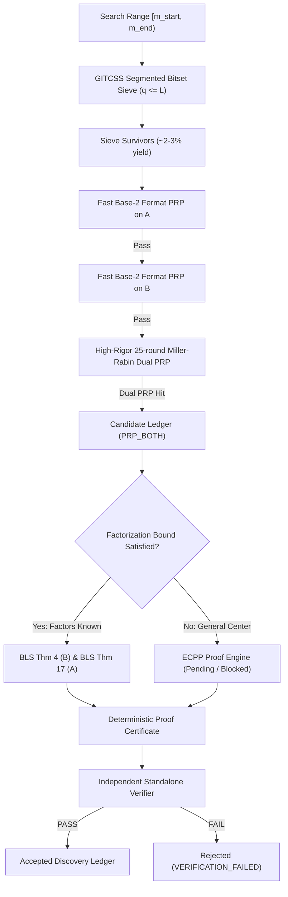

# Phase 6 Architecture Plan: Unrestricted Twin-Prime Center Search

**Architecture Date:** 14 November 2026  
**Auditor:** Antigravity Autonomous Research & Verification Agent  
**Scope:** Architectural specification for General Integer Twin-Center Segmented Sieve (GITCSS)  

---

## 1. Mathematical Formulation

Phase 6 searches for twin primes among unrestricted general integers:
\[
A = C - 1, \quad B = C + 1, \quad C = 6m, \quad m \in [m_{\min}, m_{\max}].
\]
Because $\gcd(C, 6) = 6$, $A$ and $B$ are automatically coprime to 2 and 3:
\[
A = 6m - 1 \equiv 5 \pmod 6, \quad B = 6m + 1 \equiv 1 \pmod 6.
\]
For any prime $q \ge 5$, $q$ divides $A$ or $B$ if and only if $6m \equiv \pm 1 \pmod q$.
Since $\gcd(6, q) = 1$, the modular inverse $6^{-1} \pmod q$ exists uniquely.
Thus, the two forbidden center index residue classes modulo $q$ are:
\[
m \equiv 6^{-1} \pmod q \iff q \mid (6m - 1) = A,
\]
\[
m \equiv -6^{-1} \pmod q \iff q \mid (6m + 1) = B.
\]

---

## 2. Multi-Stage Pipeline Architecture

---

## 3. Data Structures & Cache Efficiency

1. **Segment Representation:**
   - Sieve intervals of length $L = 500,000$ to $1,000,000$ centers use a packed bitset (`bytearray(L // 8)`).
   - A bit value of `0` denotes an eligible center; `1` denotes eliminated by a prime divisor $q$.
   - Memory footprint for $1,000,000$ centers is exactly $125 \text{ KB}$, fitting entirely inside L2 CPU cache ($512 \text{ KB}$ per core), maximizing memory bandwidth.
2. **Wheel-30 / Wheel-210 Pre-filtering:**
   - Pre-masks indices modulo $30$ or $210$ to eliminate multiples of 5 and 7 without branch penalties.
3. **Resumption & Coverage Ledger:**
   - Manifest file [`data/phase6_coverage_manifest.json`](file:///d:/project/Twin%20prime%20numbers/data/phase6_coverage_manifest.json) stores validated contiguous intervals $[m_{\text{start}}, m_{\text{end}}]$ with sha256 checksums, ensuring zero search gaps across parallel processes.
